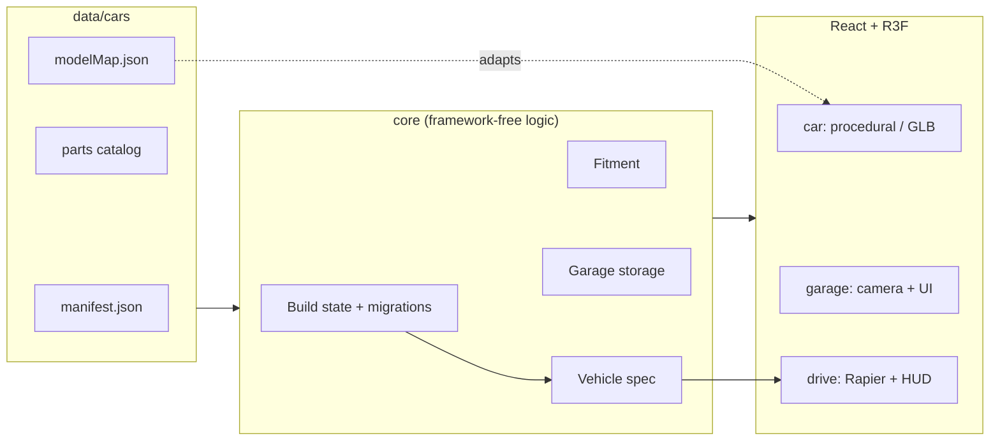

<div align="center">

# 🏁 Muscle Garage

**A browser-based 3D car customization garage and test-drive game.**
Pick a car, tune every part, then take it out on the track.


[Features](#-features) · [Getting started](#-getting-started) · [Controls](#-controls) · [Architecture](#-architecture) · [Roadmap](#-roadmap) · [Credits](#-license--credits)

</div>

---

## ✨ Features

### 🚗 Garage flow

```
 Car select  ──▶  Garage (customize)  ──▶  Test drive
   showcase         parts · paint ·           physics · track ·
   camera           wheels · vinyl            HUD · sound
```

| | |
|---|---|
| **Two cars** | **Vanta Stallion '70**, an original procedural classic muscle car, and a **2013 Ford Mustang GT** built from a ready-made GLB model |
| **Body parts** | Hood, bumpers, spoiler, side skirts and more, with live previews |
| **Paint** | Per-zone colors with metallic, matte and pearl finishes |
| **Wheels & brakes** | Rim, tire and brake options with a fitment checker (clearance, offset, arch) |
| **Vinyl editor** | Place, scale and rotate decals on the body |
| **Stance** | Ride height, camber and track width |
| **Lighting & glass** | Headlight and taillight styles, window tint |
| **Performance** | Engine, suspension and drivetrain parts that change how the car drives |
| **Garage saves** | Save slots, per-car autosave, undo / redo (IndexedDB) |
| **Photo mode** | Free camera, adjustable FOV, effects and image export |

### 🏎️ Test drive

- Rapier-based vehicle physics with a derived spec from your build (mass, grip, power, gearing)
- Lap timer, best lap, minimap and engine / tire audio
- Keyboard and gamepad support
- Adaptive graphics quality (Low / Medium / High) that steps down automatically when FPS drops

---

## 🚀 Getting started

Requires **Node.js 20+**.

```bash
npm install
npm run dev        # http://localhost:5173
```

| Command | Description |
|---|---|
| `npm run dev` | Start the dev server |
| `npm run build` | Type-check and build for production |
| `npm run preview` | Preview the production build |
| `npm test` | Run unit and physics tests (Vitest) |
| `npm run lint` | ESLint |
| `npm run format` | Prettier |

---

## 🎮 Controls

| Action | Keyboard | Gamepad |
|---|---|---|
| Throttle / Brake | `W` / `S` | `RT` / `LT` |
| Steer | `A` / `D` | Left stick |
| Handbrake | `Space` | `A` or `X` |
| Change camera | `C` | `Y` |
| Reset onto track | `R` | `B` |
| Pause | `Esc` | `Start` |
| Mute / volume | `M` | |

In the garage, drag to orbit, scroll to zoom, and use the arrow keys and `Enter` (or the D-pad and `A`) to navigate menus.

---

## 🧱 Architecture



```
src/
  app/            App shell, modes (select / garage / drive), quality
  core/           Build model, stores, fitment, drive core, model mapping
  data/cars/      Per-car data: manifest, body profile, parts, modelMap
  car/            Car scene: procedural and GLB models
  garage/         Garage scene, camera, UI
  drive/          Drive mode: Rapier physics, track, HUD, audio
  i18n/           UI strings
docs/             Plan, analysis, progress log, asset guide
```

Cars are **data-driven**: a manifest describes slots, wheel positions, paint zones, camera presets and fitment. Ready-made models that do not follow the naming rules are adapted at load time with a `modelMap.json` (scale, hidden nodes, paint zones, shared materials), so new cars need no Blender work. See [`docs/ASSET_GUIDE.md`](docs/ASSET_GUIDE.md).

---

## 🗺️ Roadmap

| Phase | Scope | Status |
|---|---|---|
| 0 – 11 | Garage, parts, paint, wheels, vinyl, stance, photo mode, drive mode, polish | ✅ Done |
| V2-1 | Multi-car architecture, car select screen, settings dialog | ✅ Done |
| V2-2 | 2013 Ford Mustang GT as the second car | ✅ Done |
| V2-3 | New HUD and driving mechanics (tire model, ABS / TC, assists) | 🚧 In progress |
| V2-4 | Mobile support (touch controls, bottom-sheet layout) | ⏳ Planned |
| V2-5 | Detailed Vanta interior and cockpit camera | ⏳ Planned |
| V2-6 | Polish, performance pass, final report | ⏳ Planned |

Details: [`docs/PLAN_V2.md`](docs/PLAN_V2.md) · [`docs/ANALYSIS.md`](docs/ANALYSIS.md) · [`docs/PROGRESS.md`](docs/PROGRESS.md)

---

## 📄 License & credits

Code and procedural assets belong to this project.

The **2013 Ford Mustang GT** model (by Ddiaz Design) is licensed under **CC-BY-NC-SA 4.0**: non-commercial use only, share-alike. The full list of third-party assets is in [`public/assets/CREDITS.json`](public/assets/CREDITS.json) and in the in-game Credits screen. Ford and Mustang are trademarks of their respective owners; this project is not affiliated with them.
